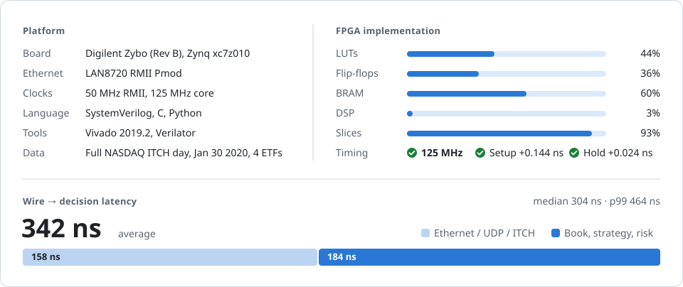
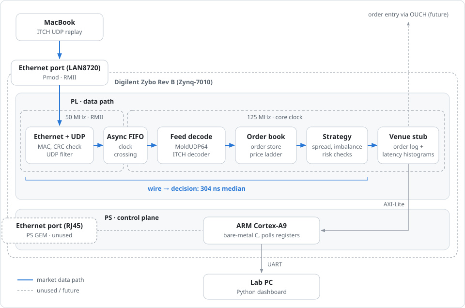

# NanoTrader

NanoTrader is an FPGA-based low-latency trading system that processes NASDAQ ITCH 5.0 market data. The pipeline includes a custom Ethernet → UDP → MoldUDP64 → ITCH decoder, an order book in hardware, and a strategy and risk module. It runs on a Digilent Zybo (Zynq-7010) with a LAN8720 Pmod as the Ethernet PHY, and goes from the last bit on the wire to a risk-checked decision in about 300 ns.

https://github.com/user-attachments/assets/755f067e-3ab2-478b-85a4-d8bd3f9954a1

## Overview

The goal of NanoTrader is to build a complete FPGA-based trading pipeline and study the tradeoffs between latency, throughput, resource usage, and design complexity.

The design focuses on:

- Custom Ethernet/IPv4/UDP packet parsing
- NASDAQ ITCH 5.0 message decoding
- Streaming ready/valid interfaces with FIFO buffering and backpressure
- Clock-domain crossing support between network and processing interfaces
- Backpressure handling and burst buffering
- BRAM-based individual-order storage
- Price-level order-book aggregation
- Hardware-based strategy and risk evaluation
- Cycle-accurate latency measurement
- A future 10 Gb/s market-data receive path
- FPGA-versus-C++ performance comparison

  

## Roadmap

- [x] **Phase 1: Establish a Cycle-Accurate Trading Baseline**  
  Transitionfrom VHDL to Systemverilog, build and synthesize a minimal `parser → quote book → strategy → risk` pipeline to establish initial latency, timing, and FPGA resource baselines.

- [x] **Phase 2: Scale to a Parameterized Multi-Symbol Datapath**  
  Expand the design to 32-bit prices, wider quantities, and configurable `NUM_SYMBOLS` support while measuring the cost of parallel book, strategy, and risk processing.

- [x] **Phase 3: Add Streaming Traffic Management**  
  Introduce ready/valid handshaking, synchronous FIFO buffering, and backpressure so the parser can safely process continuous and bursty market-data input.

- [X] **Phase 4: Build an ITCH-Driven Hardware Order Book**  
  Decode NASDAQ ITCH 5.0 order events, support common operations including Add, Execute, Cancel, Delete, and Replace, store individual orders in a BRAM-backed hash table, aggregate quantity by price level, and maintain best-bid and best-ask state.

- [ ] **Phase 5: Develop the Network Receive Pipeline**  
  Build a custom Ethernet, IPv4, and UDP parser around an AXI4-Stream interface, add clock-domain crossings where required, and stream UDP payloads directly into the ITCH parser.

- [ ] **Phase 6: Deploy and Evaluate the Complete System**  
  Validate the pipeline on FPGA hardware using ILA and hardware timestamps, report timing and resource utilization, compare it with an equivalent C++ pipeline, and migrate toward a 10 Gb/s-capable platform.

> This README will be updated as development progresses.
